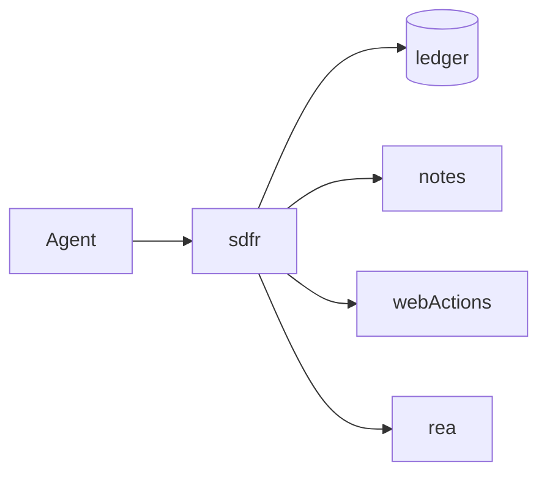

# Agent Flight Recorder (`sdfr`)

MCP gateway with a tamper-evident hash-chained ledger, deny-by-default YAML policy, emergency brake, and signed incident packets.

[](https://github.com/SkilledDragonCorp/agent-flight-recorder/actions/workflows/ci.yml)
[](./LICENSE)

## What was built

- **stdio MCP proxy** aggregating downstream servers as `<server>__<tool>`
- **SQLite ledger** (append-only triggers + SHA-256 hash chain, RFC 8785 canonical JSON)
- **YAML policy** (`allow` / `deny` / `approve`) with side-effect verb defaults
- **Emergency brake** (`sdfr brake` / `sdfr release`)
- **Incident packet** (`sdfr keygen`, `incident export|verify`) with Ed25519 signatures
- **Localhost web timeline** (Hono on `127.0.0.1`, one-time token)
- Fixture servers: `notes-server`, `web-actions` + sandbox internet; optional REA wrap



See [docs/ARCHITECTURE.md](./docs/ARCHITECTURE.md).

## What was tested

| Suite | Result | Date | Notes |
| --- | --- | --- | --- |
| unit | **pass** | 2026-10-13 | canonical, chain, redact, policy (21), approvals, signing, sqlite adapter |
| integration | **pass** | 2026-10-13 | append-only triggers, tamper detect, web token |
| e2e keyless | **pass** | 2026-10-13 | scenario 7/2/3/1 + sandbox=2; REA proxy; p95 &lt; 20 ms on 500 reads |
| skills + security | **pass** | 2026-10-13 | skills layout, gitignore, fixtures redaction |
| e2e-live | skipped | 2026-10-13 | no paid secrets required |

**Last local run:** `bun test` → **50 pass / 0 fail**, 17 files, **73.47s** (Bun 1.4.2). Featured tool: **rea-agents@6.4.0**.

## Setup

Prerequisites:

- Bun **1.4.2**
- Node **24** (`.nvmrc`)
- gitleaks (for pre-commit / local scan): `brew install gitleaks`

```bash
nvm use   # or fnm/asdf → 24
bun install --frozen-lockfile
bun run build
bun link  # optional: expose `sdfr` globally from package bin after build
```

## Tutorial

1. **Install & build**

```bash
bun install --frozen-lockfile && bun run build
```

Expected: `dist/cli.js` exists.

2. **Keygen**

```bash
bun run sdfr -- keygen --home .sdfr
```

Expected: `.sdfr/keys/ed25519.pem` (gitignored).

3. **Run the false-report scenario** (separate terminal optional for `tail`)

```bash
bun run scenario
```

Expected: JSON with `allowed:7`, `approved:2`, `denied:3`, `blocked:1`, `sandboxReceived:2`.

4. **Approve a write** — start `bun run sdfr -- run --config examples/sdfr.yaml` with a live sandbox, open the printed web URL, click Approve on pending `notes__write_note`.

5. **Denied submit_form** — call `web-actions__submit_form` to `https://tips.example.org/report`; sandbox log stays empty for that call.

6. **Brake → blocked → release**

```bash
bun run sdfr -- brake --home .sdfr
bun run sdfr -- release --home .sdfr --reason "all clear"
```

7. **Verify / tamper**

```bash
bun run sdfr -- verify --home .sdfr
```

Copy the DB, strip triggers, mutate a row → `verify` fails at that seq.

8. **Incident export + verify**

```bash
bun run sdfr -- incident export --home .sdfr --out incident-out
bun run sdfr -- incident verify incident-out
```

9. **Wrap REA / your servers** — see skill `flight-recorder-wrap` and [docs/INTEGRATIONS.md](./docs/INTEGRATIONS.md).

10. **Write a policy** — skill `flight-recorder-policy`.

## API keys

**None required** for sdfr core, fixture servers, or the REA JavaScript analysis used in keyless e2e. `GITHUB_TOKEN` is not needed.

| Variable | Required? | Used for | Where to get it | Cost / free tier | Notes |
| --- | --- | --- | --- | --- | --- |
| *(none for core)* | No | — | — | free (checked 2026-10-13) | Downstream servers you wrap may need their own keys |
| `SDFR_HOME` | No | Data dir | — | free | Defaults to `./.sdfr` |
| `SDFR_APPROVAL_TIMEOUT_SEC` | No | Approval timeout | — | free | Default 120 |

```bash
cp .env.example .env
```

## Versions tested

| Component | Version |
| --- | --- |
| Bun | 1.4.2 |
| Node | 24 |
| rea-agents | 6.4.0 |
| @modelcontextprotocol/sdk | 1.32.1 |

## Troubleshooting

1. **`blocked_by_brake`** — run `sdfr release --reason "..."` or delete `.sdfr/BRAKE.lock`.
2. **Approval hangs** — open the web timeline or lower `SDFR_APPROVAL_TIMEOUT_SEC` in tests.
3. **REA slow to start** — first MCP connect can take ~20–40s; e2e timeout is 180s.
4. **Sandbox empty when expecting allows** — ensure `SANDBOX_INTERNET` points at the live sandbox URL.
5. **`engine-strict` install errors** — use Node 24 and Bun 1.4.2 as pinned.
6. **gitleaks missing in prepare** — install the binary; lefthook prepare is best-effort (`|| true`).

## Using these skills in Claude Code and Cursor

Skills live only under [`.claude/skills/`](./.claude/skills/) (no `.cursor/skills` or `.agents/skills` mirrors). Cursor loads `.claude/skills` for compatibility ([Cursor skills docs](https://cursor.com/docs/skills); [Claude Code skills](https://code.claude.com/docs/en/skills)).

| Skill | Invoke |
| --- | --- |
| `flight-recorder-wrap` | `/flight-recorder-wrap` or ask the agent to wrap a server |
| `flight-recorder-incident` | Human-only (`disable-model-invocation`) |
| `flight-recorder-policy` | `/flight-recorder-policy` |

Confirm: Claude Code `/skills`; Cursor **Customize → Skills**. Global install optional: copy into `~/.claude/skills` or `~/.cursor/skills`. Validate: `bun test tests/skills`.

## Security

See [SECURITY.md](./SECURITY.md). Locally:

```bash
gitleaks git --redact --exit-code 1
bun audit
bun test tests/security
```

Never commit `.env` or `.sdfr/keys/`. Contact: **hello@skilleddragon.com**.

## Credits

- [Model Context Protocol SDK](https://github.com/modelcontextprotocol/typescript-sdk)
- [rea-agents](https://github.com/morluto/rea) (MIT)

## License

Apache-2.0 — see [LICENSE](./LICENSE) and [NOTICE](./NOTICE).

Built by SkilledDragon LLC, skilleddragon.com
