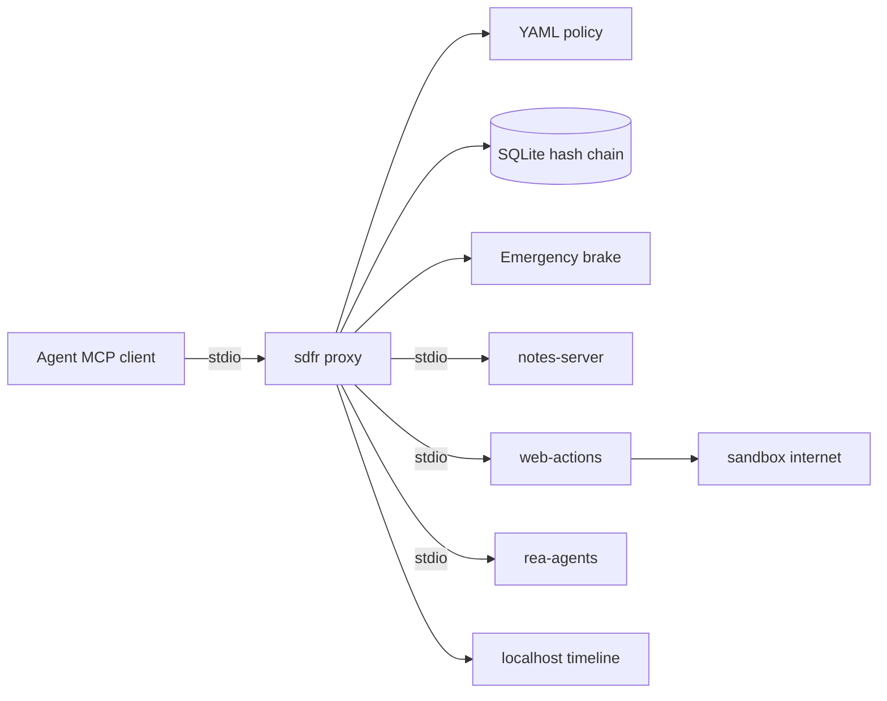

# Architecture

- **Proxy** aggregates tools as `<server>__<tool>`, prefixes descriptions with `[recorded by sdfr]`.
- **Ledger** append-only events with `prev_hash`/`hash` (SHA-256 over prev + RFC 8785 canonical JSON).
- **Policy** deny-by-default; side-effect verbs denied unless allowlisted; `approve` pauses for broker/UI.
- **Brake** lockfile + meta flag; in-flight and new calls return `blocked_by_brake`.
- **Incident** Ed25519-signed manifest over packet files.
